# optpricer: Options Pricing Library

An educational, tested Python library for pricing and researching vanilla options. It covers
Black-Scholes-Merton prices and Greeks, CRR and Leisen-Reimer trees, finite differences
(explicit / implicit / Crank-Nicolson with Rannacher start-up), American exercise solved as a linear
complementarity problem with PSOR, Monte Carlo with honest uncertainty, a diagnostic implied-vol
solver, option-chain cleaning, smiles and surface diagnostics, and a self-financing delta-hedging
simulator. A local Streamlit app sits on top of the library.

> **Educational use only.** Not production software, not investment advice. All surface results here
> use **synthetic** data; see [Data provenance](#data-provenance).

## What is implemented

| Area | Status | Where |
|---|---|---|
| BSM European prices with continuous yield, vectorised, stable edge cases | implemented, tested | `src/optpricer/bsm.py` |
| Greeks: delta, gamma, vega, theta (calendar), rho, psi, vanna, volga; display-unit conversions | implemented, tested | `bsm.py`, `conventions.py` |
| CRR, CRR (n, n+1) averaging, Leisen-Reimer (odd n), European & American, lattice Greeks, exercise boundary | implemented, tested | `binomial.py` |
| Log-space theta-scheme FD (explicit, implicit, CN + Rannacher), Thomas solver, stability checks | implemented, tested | `pde.py` |
| American PDE via projected SOR (LCP) with convergence and complementarity diagnostics | implemented, tested | `pde.py` |
| European Monte Carlo (exact terminal GBM, SE, CI, antithetic pairs, chunking) | implemented, tested | `mc.py` |
| Optional cross-check against the sibling `monte-carlo-sim` package (`mcsim`) | implemented, tested (skips if absent) | `mc.mcsim_crosscheck` |
| Implied vol: bounds, bracket expansion, safeguarded Newton, Brent fallback, diagnostics | implemented, tested | `implied_vol.py` |
| Synthetic European chains, snapshots with metadata, cleaning with reasons | implemented, tested | `market.py` |
| Optional delayed yfinance download (American-style, labelled) | implemented; one run made, data unusable (market closed) | `market.fetch_yfinance_chain`, `scripts/fetch_snapshot.py` |
| Parity-implied forwards with SEs, smiles, total-variance surface, arbitrage diagnostics, RN density | implemented, tested | `surface.py` |
| Self-financing delta-hedging simulator with audit ledger | implemented, tested | `hedging.py` |
| Unified API, CLI, experiment drivers, executed notebooks, local Streamlit app | implemented; app smoke-tested | `api.py`, `cli.py`, `experiments/`, `notebooks/`, `app/` |
| Longstaff-Schwartz American MC, SVI/SABR calibration, discrete dividends, Heston, Jaeckel IV | **not implemented** | - |

American options are priced by **two** independent families (trees and PDE). BSM and terminal-payoff
MC are refused for them.

## Installation

Python 3.11+ (developed and tested on 3.14.4, Windows). From the project root:

```powershell
python -m venv .venv
```

```powershell
.venv\Scripts\python -m pip install -e ".[dev,app,notebooks,market]"
```

On macOS/Linux use `.venv/bin/python`. `requirements.txt` lists the same dependencies. The optional
`mcsim` cross-check needs the sibling `monte-carlo-sim` project installed separately; it is skipped if
the project is absent.

## Quick start

```python
from optpricer import Option, MarketData, price, price_all

mkt = MarketData(S=100, r=0.05, q=0.0, sigma=0.20)
price(Option("call", 100, 1.0), mkt, method="bs").price            # 10.450584
price(Option("put", 100, 1.0, "american"), mkt, method="lr", n=501).price
price(Option("put", 100, 1.0, "american"), mkt, method="cn", n_space=800, n_time=800).diagnostics
price_all(Option("put", 100, 1.0), mkt)                             # every supported method
```

```powershell
.venv\Scripts\optpricer price --kind put --style american --method lr --n 501
```

```powershell
.venv\Scripts\optpricer compare --kind call --S 100 --K 105 --T 0.5 --sigma 0.25
```

## Running the experiments

`fast` mode (default) regenerates every figure and table in about 1-2.5 minutes. `research` mode uses
larger budgets (configured but **not executed** for the committed results).

```powershell
.venv\Scripts\python scripts\run_all.py --mode fast
```

Individual stages: `scripts/run_method_comparison.py`, `run_american_examples.py`, `run_convergence.py`,
`run_greeks_validation.py`, `run_surface.py`, `run_hedging.py`. Notebooks are rebuilt and executed with
`scripts/build_notebooks.py`. To download a delayed chain (network needed; run during US market hours):

```powershell
.venv\Scripts\python scripts\fetch_snapshot.py --ticker SPY
```

## Tests and checks

```powershell
.venv\Scripts\python -m pytest -m "not slow and not app"
```

```powershell
.venv\Scripts\python -m pytest --cov=optpricer
```

```powershell
.venv\Scripts\python -m ruff check src tests app scripts
```

```powershell
.venv\Scripts\python -m mypy
```

Results from the final run of this build: **133 passed** (fast, slow and app tests); **91%** line
coverage of the core package (experiment drivers excluded; they are executed by `run_all.py`);
ruff: all checks passed; mypy: no issues in 22 source files.

## Local app

```powershell
.venv\Scripts\python -m streamlit run app/streamlit_app.py
```

Tabs: pricing comparison, Greeks, implied vol and smiles, convergence, delta hedging. Unsupported
method/style combinations are disabled, units are shown, MC CIs and PSOR diagnostics are displayed,
and market data is fetched only when you press the fetch button (cached for 15 minutes, labelled
delayed/American). The app is not deployed and has no public link.

## Results (fast mode, generated by `scripts/run_all.py`)

All inputs below are model parameters or synthetic data. Every figure's numbers are in `results/tables`.

### Method agreement (European, 120 cases: K 80-120, T 1 month-2 years, 3 (r, q, sigma) scenarios)

| Method (budget) | max abs error vs BSM | median | cases > 1e-3 |
|---|---|---|---|
| CRR n=1000 | 5.4e-3 | 7.0e-4 | 44 |
| Leisen-Reimer n=201 | 2.6e-5 | 4.0e-6 | 0 |
| Crank-Nicolson 400x400 (Rannacher) | 8.0e-4 | 1.2e-4 | 0 |
| Monte Carlo 200,000 paths | sampling error: 5% of cases beyond 2 SE, max abs z 2.96 | | |

Headline (S=K=100, T=1, r=5%, q=0, sigma=20%):

| Option | BSM | CRR n=1000 | LR n=201 | CN 400x400 | MC 200k (+- SE) |
|---|---|---|---|---|---|
| European call | 10.450584 | 10.448584 | 10.450575 | 10.450713 | 10.4388 +- 0.0328 |
| European put | 5.573526 | 5.571527 | 5.573517 | 5.573474 | 5.6087 +- 0.0195 |
| American put | n/a | 6.089595 | 6.088806 | 6.089759 (PSOR 5,313 iters) | n/a (no LSM) |

American put reference: **6.09034 +- 3.5e-5** (LR n=8001; uncertainty = max gap to LR n=4001 and CN
3200x3200).

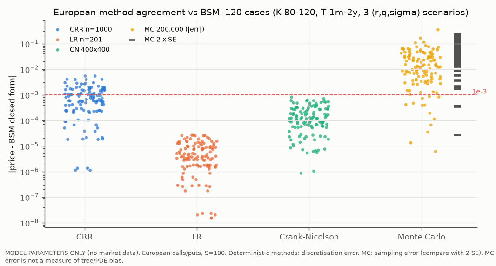

### Convergence

Observed orders: CRR 1.02 and LR 1.99 (European ATM); CN space 1.99, CN + Rannacher time 2.02,
implicit time 1.09. American put trees converge roughly first order and irregularly.

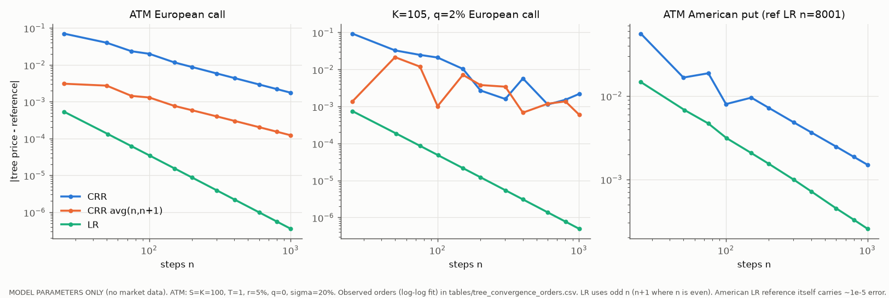
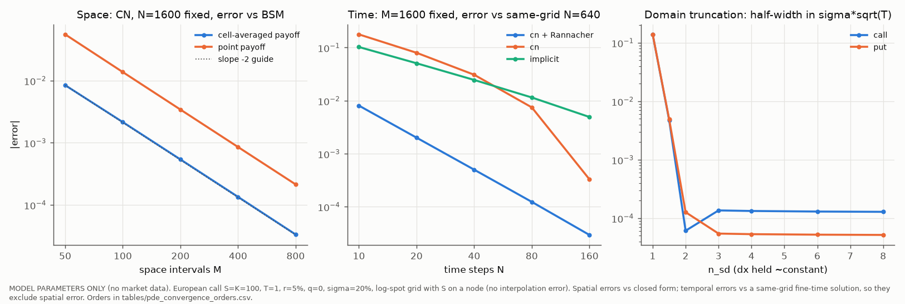
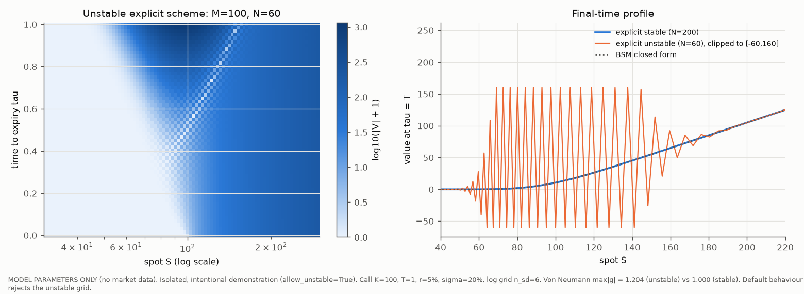

### American exercise

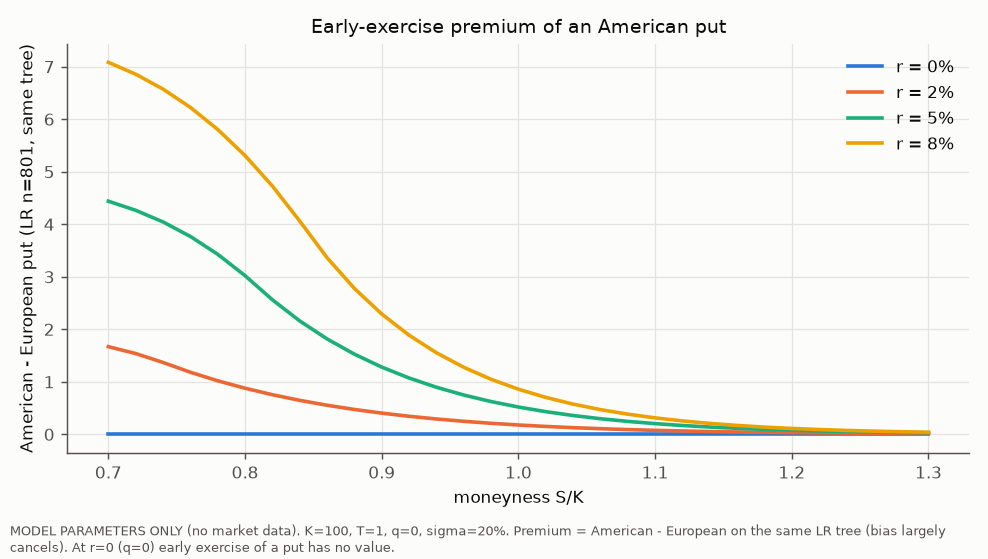
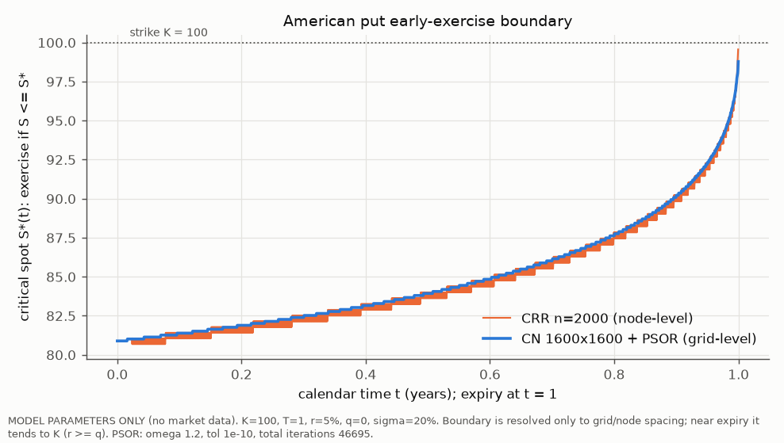

### Greeks and implied volatility

The PDE identity holds to about 2e-16 (relative) on 2,000 random cases in raw units. IV round-trip:
35 of 168 grid cases have no time value at double precision and are reported as boundary cases. Where
the identifiability flag is off, sigma is recovered to 5.4e-10. Prices are reproduced to 7e-11
wherever a finite IV is returned.

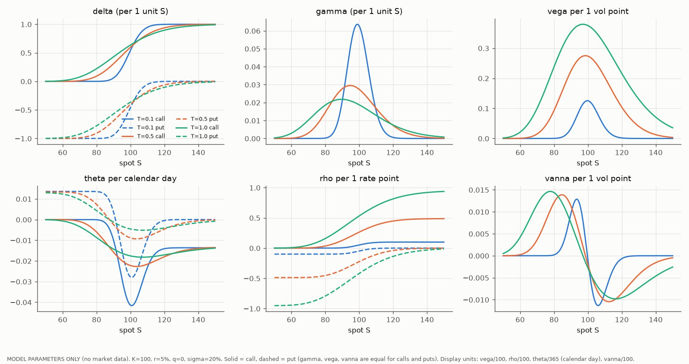
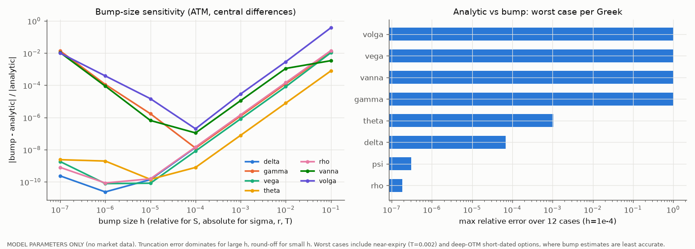
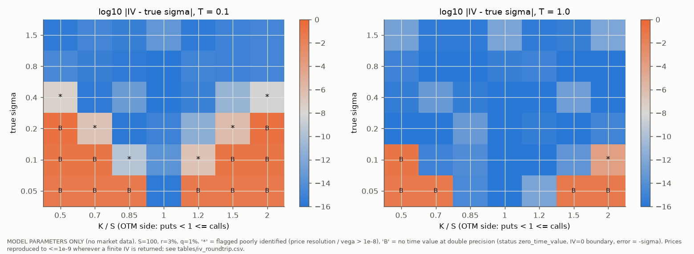

### Synthetic chain: cleaning, smiles, surface, arbitrage diagnostics

37 of 492 synthetic quotes were rejected, including all 12 injected defects. Parity-implied forwards are
within 2.2 SE of the truth. Smile IVs are within 8e-3 of the true SSVI vols (median 3e-4). The true
surface gives zero violations. Noisy mids give mid-only violations, none executable. Injected
violations are all detected.

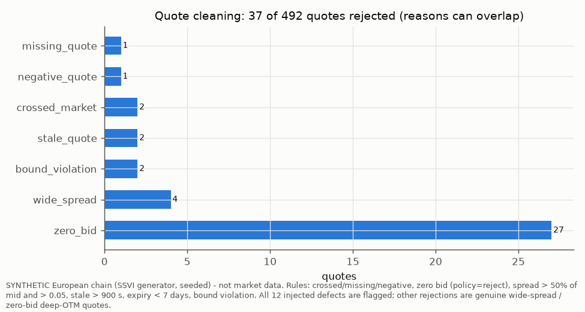
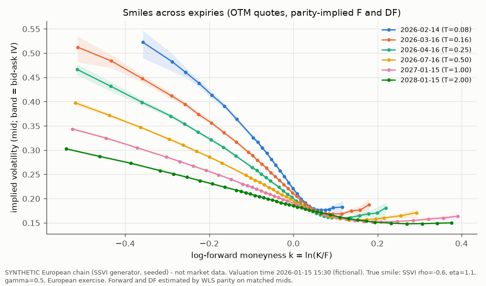
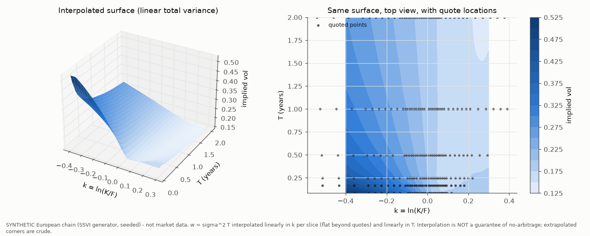
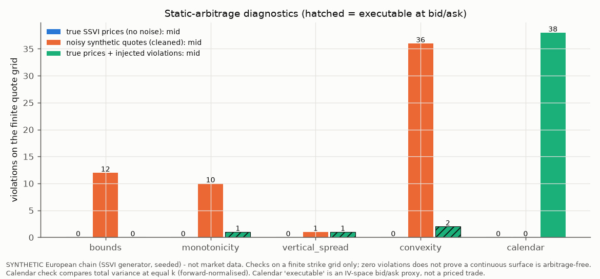

### Delta hedging (simulated)

Same 10,000 paths for every frequency. The P&L SD falls 3.25 -> 1.47 -> 0.44 -> 0.22 (4/21/252/1000
rebalances per year), with mean P&L within 2 SE of zero when implied = realised. Mean P&L is -1.19 at
+3 vol points of realised-implied mismatch. With costs, RMS P&L has an interior minimum. The audit
ledger reconciles to 1.9e-14.

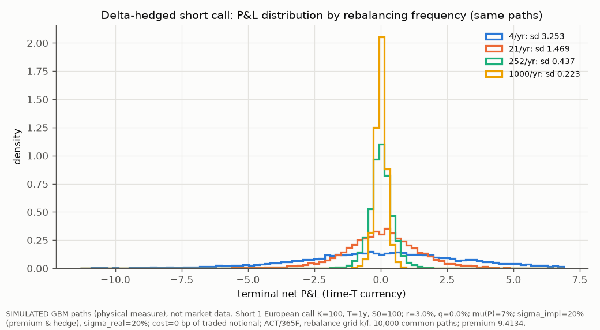
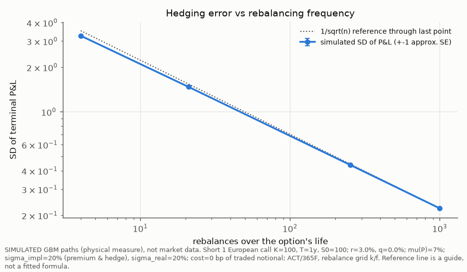
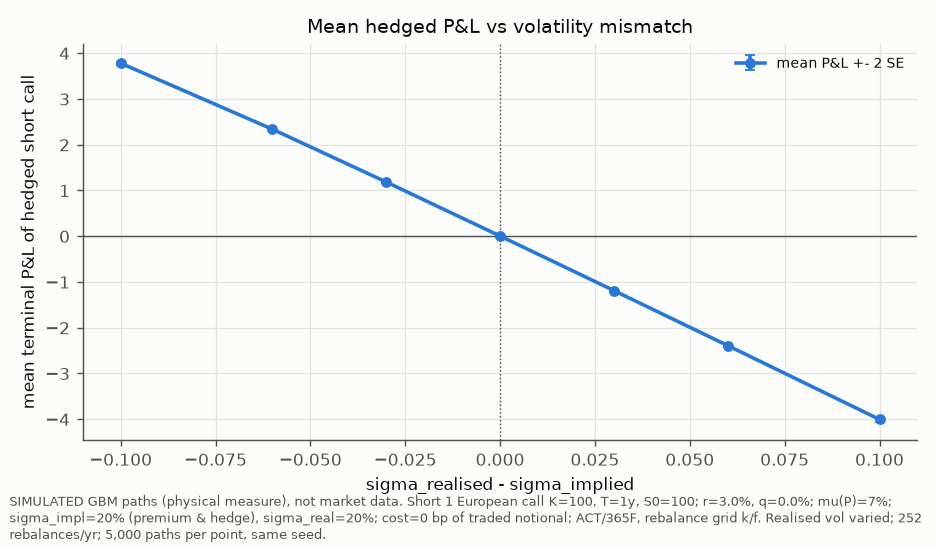
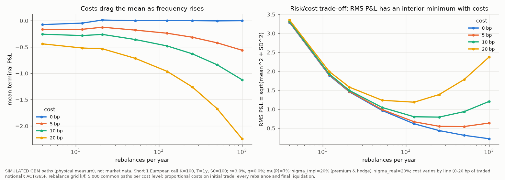
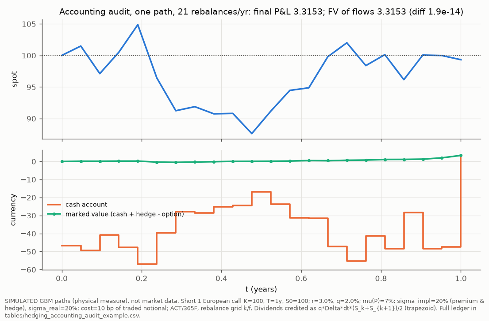

## Data provenance

* **Pricing, convergence, Greeks, IV:** model parameters only.
* **Smiles, surface, arbitrage:** `SYNTHETIC` European chain generated by
  `market.synthetic_european_chain` (seed 7; SSVI truth; fictional timestamps; 12 deliberately injected
  defects), saved to `data/synthetic/`.
* **Hedging:** simulated GBM paths (seed 42).
* **Market snapshot:** `data/snapshots/SPY_20261124T115114Z.csv` was downloaded once via yfinance
  (delayed, American-style). It was taken before the US open, so 99.1% of contracts had zero bids. It is
  **not used** in any result. See `docs/market_data_policy.md`.
* `results/run_metadata.json` records versions, configs, seeds, stage runtimes and provenance.

## Concepts in brief

* **Risk-neutral pricing.** Price = discounted expected payoff under a measure where the asset grows
  at `r - q`. Real-world drift does not enter the price.
* **European vs American.** European options exercise only at expiry. American options can exercise
  any time, so their value solves an obstacle problem (`V >= payoff`). There is no closed form, and
  parity becomes an inequality.
* **Greeks and units.** Sensitivities are stored raw (per 1.00 of sigma or r, per year). Screens show
  per vol point, per rate point and per calendar day (`docs/greek_conventions.md`).
* **Trees vs PDE vs MC.** Trees and PDE discretise the same problem and carry deterministic
  discretisation error, which shrinks with refinement. MC carries random sampling error measured by
  its SE. A small MC SE says nothing about tree or PDE bias.
* **Early exercise.** A put is exercised when the interest earned on `K` outweighs the remaining
  optionality. With `q = 0` and `r >= 0` a call is never exercised early.
* **IV identifiability.** When vega is close to zero, many vols give the same price, so the solver
  promises to reproduce the price, not a specific sigma.
* **Smile and surface.** IV varies with strike and maturity. Total variance `sigma^2 T` in log-forward
  moneyness is a convenient interpolation space.
* **Arbitrage diagnostics.** These are finite-grid checks on quotes: bounds, monotonicity, convexity,
  calendar. Passing them does not certify a continuous arbitrage-free surface.
* **Self-financing hedging.** After the premium, every trade is funded from the cash account. P&L is
  what is left at expiry.
* **Gamma/theta and vol P&L.** A hedged short option earns theta and pays gamma. On average this
  nets to roughly `1/2 Gamma S^2 (sigma_imp^2 - sigma_real^2) dt` per step, which is an approximation.
* **Transaction costs.** More frequent hedging reduces risk but raises costs, so there is an optimum
  frequency for a given cost level.

## Corrections to the build guide

The guide's numerical benchmarks (Hull 4.76/0.81, BS 10.4506/5.5735) are correct after rounding.
Several claims were corrected or qualified, including "four independent American methods", Smax = 4K,
the simplified explicit stability rule, uniform `O(1/n^2)` and 1e-3 accuracy claims, the 1e-8 IV
round-trip claim, the rate-unqualified American-call equality, and treating SPY/AAPL (American)
quotes as European for forwards and arbitrage checks. The full list is in
[`docs/mathematical_validation.md`](docs/mathematical_validation.md).

## Documentation

[methodology](docs/methodology.md) · [numerical methods](docs/numerical_methods.md) ·
[Greek conventions](docs/greek_conventions.md) · [market-data policy](docs/market_data_policy.md) ·
[arbitrage diagnostics](docs/arbitrage_diagnostics.md) · [hedging accounting](docs/hedging_accounting.md) ·
[mathematical validation](docs/mathematical_validation.md) · [limitations](docs/limitations.md) ·
[interview notes](docs/interview_notes.md)

## Limitations

The model has constant parameters and a continuous dividend yield only. There is no LSM, SVI or
discrete-dividend support. Accuracy figures are measured for the stated parameters and are not
guarantees. All surface work uses synthetic data. See [`docs/limitations.md`](docs/limitations.md).
